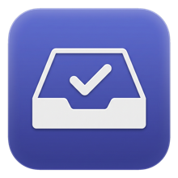

<div align="center">



# Stowly

**Save a post on your phone. It's waiting on your Mac, parsed, summarized, and filed.**

Turn the posts you save from **Instagram · TikTok · YouTube · LinkedIn · X · Handshake**
into an actionable, auto-categorized task queue that lives in your MacBook's notch.

`Swift 6` · `SwiftUI` · `SwiftData` · `macOS 14+` · `123 tests`

</div>

---

You save a hundred posts and never look at them again. Stowly fixes that. Share a post from
your phone (or paste a link on the Mac) and a glassy panel drops from the notch with a card for
it. The card carries the actual task pulled out of the caption, a short summary, the links, the
platform badge, and a one-tap **Open on …** button. The posts you saved finally turn into things
you actually do.

It's a menu-bar app. No Dock icon, no window to manage. Just a pill in the notch that expands
when you hover.

> _Drop a screen recording or GIF here once you have one. The notch expand is the money shot._

## Features

- **One-tap capture from your phone.** An iOS Share Sheet shortcut sends the post to your Mac
  over a free relay. Works on cellular, no account, no cloud storage.
- **Reads the video, not just the caption.** yt-dlp + Whisper (or Gemini) transcribe the audio
  and read on-screen text, so the summary reflects what the post actually says.
- **Auto-filed into folders.** A model sorts each post into the right folder (Learn, Apply Jobs,
  Internships, and so on) so the queue organizes itself.
- **Tracking tab.** Start a live work timer on any card, pause and resume it, and the app banks
  the time you actually spent. Closing the app doesn't pad your numbers.
- **Search.** Filter the whole library by task, summary, or creator.
- **Multi-select and bulk actions.** Select a batch and complete, archive, or delete them in one go.
- **Local-first.** Everything lives in a local SwiftData store. The relay only ever carries a link.

## How it works

```
iPhone Share Sheet ──▶ ntfy relay ──▶ Mac subscription ──▶ Extract ──▶ Understand ──▶ Card
   (shortcut)          (link only)      (streaming)        yt-dlp/      Gemini/        in the
                                                           Whisper      Ollama         notch
```

1. **Ingestion.** An iOS Shortcut POSTs the shared post to a free public relay
   ([ntfy.sh](https://ntfy.sh)) on a secret per-user topic. The Mac holds a streaming
   subscription and turns each link into a card. It pulls the URL out of whatever you share,
   whether that's a bare link or share text with a link buried in it (LinkedIn/X).
2. **Parsing.** A helper (yt-dlp + ffmpeg + Whisper) grabs the caption and video and transcribes
   the audio. For login-gated or unfetchable posts (Handshake), it falls back to an Open Graph
   scrape, so you always get a best-effort link card.
3. **Understanding.** A model turns the raw text/video into `{ task, summary, links, folder }`.
4. **Storage.** A local SwiftData database of posts and folders.
5. **UI.** A [DynamicNotchKit](https://github.com/MrKai77/DynamicNotchKit) panel: hover the pill
   to expand the queue, then tap a card for the detail view with links and a platform-branded
   **Open on …** button.

## Platforms

| Platform | Extraction | Badge |
|---|---|---|
| Instagram | full (video + transcript) | camera, gradient |
| TikTok · YouTube · X | full (yt-dlp) | per-platform color |
| LinkedIn | full when public, else link card | blue `in` |
| Handshake | link card (login-gated) | green `h` |

## Quick start

Stowly is a Swift Package, so there's no `.xcodeproj` to open.

```bash
./build_app.sh        # produces Stowly.app
open Stowly.app
```

Move `Stowly.app` to `/Applications` and add it under **System Settings → General → Login Items**
to keep it running. It lives in the menu bar; quit from the tray icon → **Quit**.

### Prerequisites

You need **full Xcode**, not just the Command Line Tools. SwiftData (`@Model`) and the SwiftUI
macros depend on compiler plugins that only ship with Xcode:

```bash
sudo xcode-select -s /Applications/Xcode.app/Contents/Developer
sudo xcodebuild -license accept
```

For the extraction helper and the local model:

```bash
brew install yt-dlp ffmpeg whisper-cpp
ollama pull llama3.2        # local model (Gemini below is recommended instead)
```

### Development

```bash
swift build
swift test            # 123 tests across 12 suites
swift run             # ties the app to the terminal, so keep it open while posts process
```

## Send posts from your iPhone

Posts flow in over a free relay ([ntfy.sh](https://ntfy.sh)). No iCloud, no account, no cloud
storage. Set it up once.

**On the Mac:** menu-bar icon → **Set Up iPhone Sync…**. It copies your private inbox address
(`https://ntfy.sh/stowly-…`) to the clipboard. **Keep it secret:** anyone with it could read
your saved links or push junk into your queue.

**On the iPhone**, build the Shortcut:

1. **Shortcuts** → **+** → rename it **Stowly**.
2. Tap **ⓘ** → **Show in Share Sheet** ON → **Receive Input** → set the types to **URLs _and_
   Text** → **Done**. (Text matters: LinkedIn/X share the post as text with a link, not a bare
   URL, so without it the action stays hidden there.)
3. **Add Action** → **Text** → tap the field → **Insert Variable** → **Shortcut Input**.
4. **+** → **Get Contents of URL** → **Show More**: **URL** = your address, **Method** = **POST**,
   **Request Body → File** (not JSON/Form) = the **Text** from step 3.
5. **Done.** From any post → **Share** → **More** → **Stowly**.

Posts appear on the Mac within a second or two, even on cellular. Anything shared while the Mac
is asleep is caught up on next launch (ntfy caches about 12 hours).

> The relay only carries links. The address is the only secret, stored locally in `UserDefaults`,
> never committed. The Mac drops anything that isn't a new supported-platform link.

## AI model: local Ollama (default) or free Gemini

By default, posts are understood by a **local** model via Ollama (`llama3.2`). It's private, free,
and offline, but small: weaker summaries, and it can't see the video.

For much better results, plug in a free **Gemini** key: menu-bar icon → **AI: Use Gemini (set API
key…)** → paste a key from [aistudio.google.com/apikey](https://aistudio.google.com/apikey). With
Gemini on, the app sends the post's **video**, so it reads the spoken audio, the on-screen text,
and the visuals. Clear the key anytime to switch back to local.

- The key is stored in the macOS **Keychain**, never in files or git.
- **Privacy:** with Gemini active, a size-capped (≤480p) copy of the video is uploaded to Google
  for processing, then deleted from the local cache after the call.
- Override the model with the `geminiModel` UserDefaults key (default `gemini-3.1-flash-lite`).

## Storage

A local SwiftData store at `~/Library/Application Support/Stowly/Library.store` (auto-migrated
from the old location on first launch). Starter folders and sample posts are seeded on first run.
Add a post manually via the menu-bar icon → **Add Reel from Clipboard** (copy a supported link
first).

## Tech

Swift 6 + SwiftUI · [DynamicNotchKit](https://github.com/MrKai77/DynamicNotchKit) · SwiftData ·
yt-dlp / Whisper helper · Gemini (multimodal) or Ollama.

## Project layout

```
Package.swift
Sources/Stowly/
  main.swift              # AppKit bootstrap (.accessory agent)
  AppDelegate.swift       # status-item menu + launches the notch
  NotchController.swift   # owns DynamicNotch; pill ⇄ expand interaction
  LibraryStore.swift      # core state: posts, folders, tracking, search, selection
  Keychain.swift          # Gemini key storage
  Models/                 # Reel, ReelLink, Folder, Platform, SeedData
  Pipeline/               # InboxRelay, ProcessingQueue, ReelExtractor, ReelProcessor
  AI/                     # LLMProvider (Ollama), GeminiProvider
  Views/                  # Theme, CompactPill, ExpandedQueueView, ReelCard,
                          #   ReelDetailView, PlatformBadge, Tracking/Search prompts
Tests/StowlyTests/        # 123 tests across 12 suites
```
